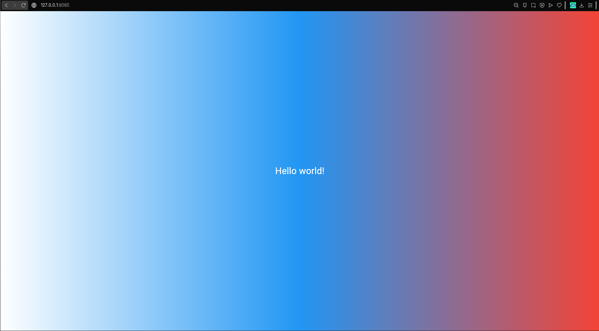

# first_flutter_app

Моя лаба по Flutter.

Автор: Каторжин Максим Вячеславович  
Группа: ИСП-241

## Стек
- Flutter 3.x
- Dart 3.x
- Web (Chrome)
- VS Code

## Скриншот

## Запуск
1. Клонировать репозиторий
2. Перейти в папку проекта
3. `flutter pub get`
4. `flutter run -d chrome`

## Что изучил
- Как создать Flutter-проект
- Виджеты (Text, Scaffold, Center, Container)
- Hot Reload и Hot Restart
- Градиент и стили текста
- DevTools и Flutter Inspector